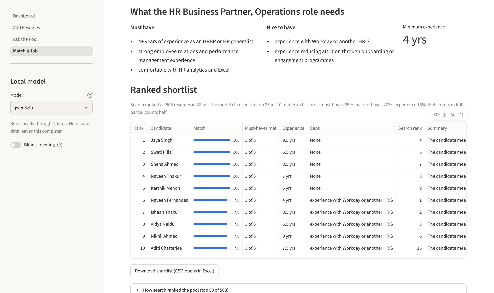
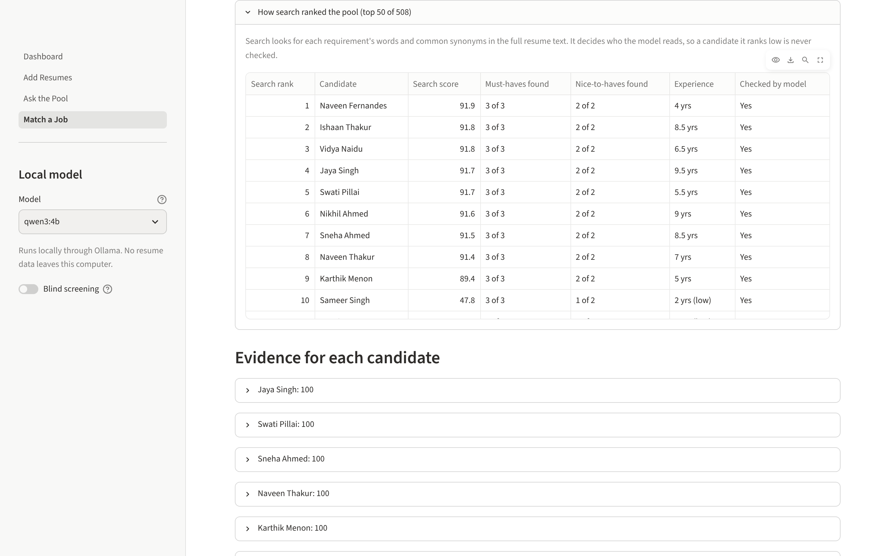
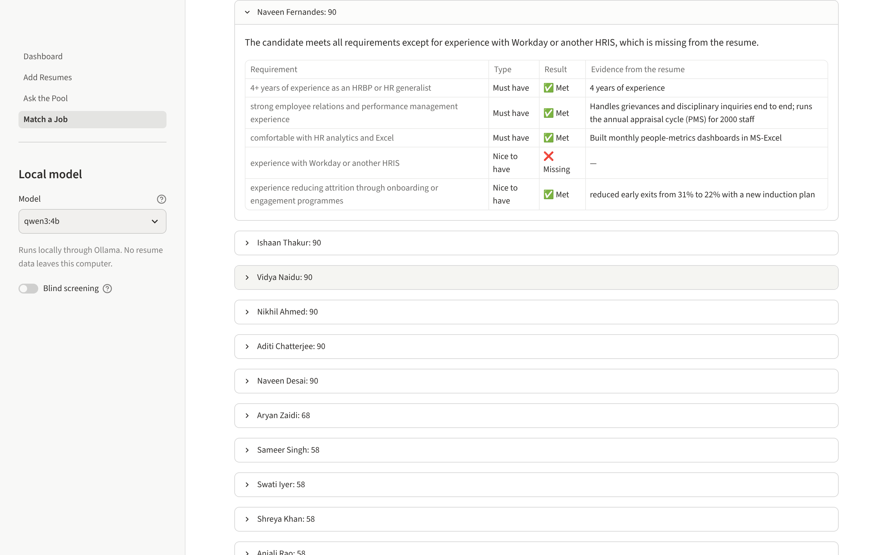
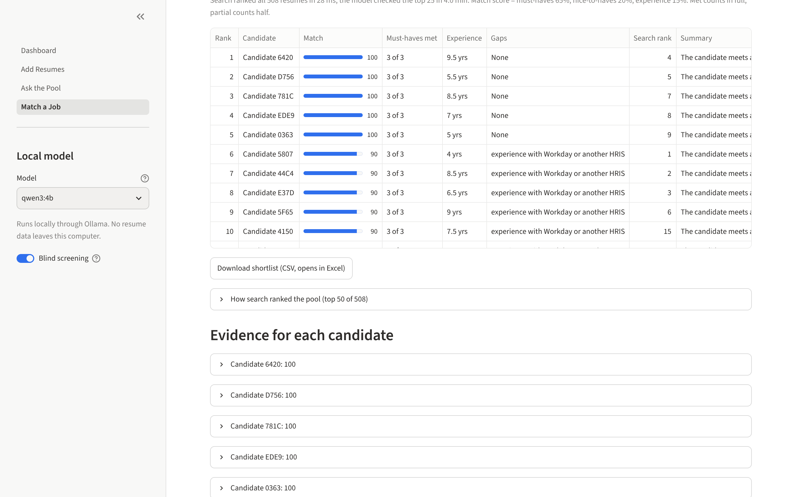
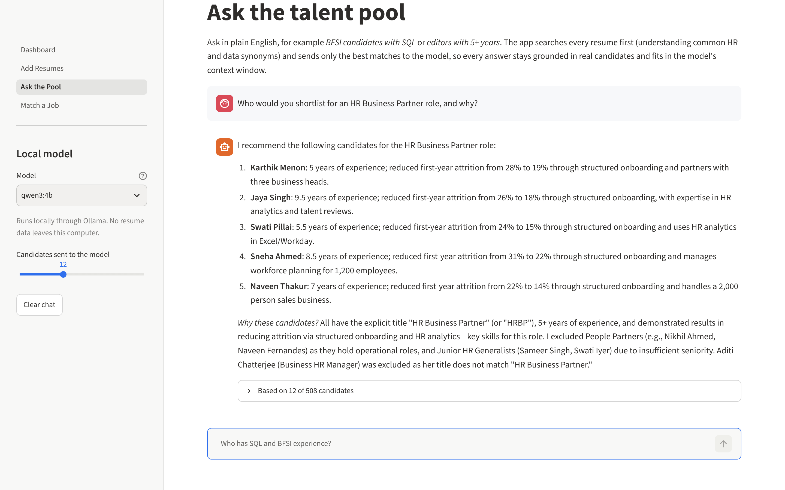

# ShortlistLens

**Offline, evidence-backed CV shortlisting that runs on your laptop, with no licence, cloud or per-CV fees.**

Paste a job description. A fast search ranks hundreds of CVs in milliseconds, then a local AI model checks the top candidates against every requirement and quotes the line in the CV that proves it. The score is calculated in code, names can be hidden, and the recruiter makes the call. It works without an internet connection, so no candidate data leaves the machine. It is built entirely on free, open-source software and an open model, so there is nothing to buy beyond the laptop, and the cost doesn't grow with the number of CVs.

https://github.com/user-attachments/assets/3e690eba-8c2c-4680-bf77-25e4d3f917bb

<sub>Narrated two-minute demo on 500+ synthetic CVs. The model's waiting time is cut and the captions say how long it really took. Model: qwen3:4b through Ollama on an M4 MacBook Air. [Download the MP4](docs/demo.mp4).</sub>

<details><summary>Silent preview (GIF)</summary>


</details>

> A clean rebuild, using synthetic resumes only, of a tool I first built during my time as an HR Business Partner, for an in-house talent acquisition team.

## The HR problem

- **Slow, inconsistent shortlisting.** Recruiters read resumes one at a time. Two people screening the same pile often produce different shortlists.
- **Candidate data is personal data.** Pasting resumes into a cloud AI tool sends them to an outside provider. Under India's DPDP Act, that needs care.
- **AI screening usually comes with usage fees.** Cloud AI tools charge per seat, per CV or per request, and the bill grows with every hiring drive.
- **Generic AI scores don't help.** A single "fit score" with no job in mind tells a recruiter very little, and it can't be checked.

## What it does

| Feature | What the recruiter gets |
| --- | --- |
| **Match a Job** | Paste a job description. Search ranks every resume in the pool in under a second. The model then checks the top candidates against each must-have and nice-to-have (met, partial or missing) and quotes the line that proves it. The match score is calculated from those checks, not guessed by the model. The shortlist exports to Excel. |
| **Bulk import** | Load hundreds of resumes from Terminal with an ETA. Stop and resume any time; already-imported files are skipped. |
| **Blind screening** | One switch hides candidate names everywhere, so the shortlist is about evidence. |
| **Ask the Pool** | Plain-English questions such as "Who would you shortlist for an HRBP role?" The answer comes only from candidates in the pool, and the app shows which candidates it used. |
| **Dashboard** | Upload PDF or Word resumes. The app extracts skills, experience and role, removes duplicates, and lets you filter the pool and download any original resume. |

## Results: 508 CVs on an M4 MacBook Air

The full pipeline was run on 508 synthetic CVs (the 500-CV pool plus the 8 originals) with the real local model, qwen3:4b, against the sample HR Business Partner job. The pool hides 13 genuinely qualified candidates, and an answer key says who they are.

| Step | What happened |
| --- | --- |
| Import (once) | 500 CVs in 79 minutes, 9.5 s each. No failures, and every candidate name was extracted correctly |
| Search | All 508 CVs ranked in under half a second. 11 of the 13 qualified candidates made the top 25 |
| Detailed check | The model checked the top 25 in about 4 minutes and put **all 11 qualified candidates in the top 11 places** (scores 90 to 100) |
| Near-misses | Junior HR executives, HRIS analysts and payroll specialists, who look similar on keywords, scored 68 or lower |
| Running cost | No licence, cloud or per-CV fees. Everything ran on the laptop, offline |

Search narrows hundreds of CVs to a manageable shortlist. The model then separates the people who actually do the job from the people who only share its vocabulary. On the original 8-CV set, the same before-and-after showed up: Karthik was joint last on a generic fit score and first once he was checked against the job.

| Ranked shortlist (508 CVs) | How search ranked the pool |
| --- | --- |
|  |  |
| **Evidence for each requirement** | **Blind screening** |
|  |  |

**Ask the Pool**



## Scale: 500 resumes and beyond

The model is the slow part, about 10 seconds per CV on an M4 MacBook Air. So it only reads what a fast search puts in front of it:

| Stage | What happens | Time for 500 resumes |
| --- | --- | --- |
| Import (once) | The model reads each CV once and stores the profile and text | 79 minutes for 500, in the background |
| 1. Search | BM25 ranking over every CV's full text, with HR and data synonyms ("HRBP" also finds "People Partner", "SQL" also finds "PostgreSQL"). No model calls | under half a second |
| 2. Detailed check | The model checks the top 25 against every requirement, with evidence | ~4 min, however big the pool |

**Does search find the right people?** The model never sees a candidate search ranks low, so I measured it on the resume text alone, without the model (`python tools/eval_search.py`). `sample_pool_500/` holds 500 synthetic resumes, with 12 genuinely qualified candidates planted for each sample job and an answer key. A third of them are written in wording that isn't in the synonym list, to test search honestly.

| Job | Found in top 10 | **Found in top 25** | Found in top 50 | Top 25 without synonyms |
| --- | --- | --- | --- | --- |
| HR Business Partner | 8 of 12 | **10 of 12** | 10 of 12 | 9 of 12 |
| Data Analyst, Lending | 9 of 12 | **12 of 12** | 12 of 12 | 9 of 12 |

Every candidate described in standard or synonym wording was found in the top 25. The two misses are HR profiles written as "worker issues", "year-end reviews" and "Google Sheets", wording the synonym list doesn't cover. Run it yourself with `python tools/eval_search.py`.

| Pool size | On a laptop |
| --- | --- |
| Up to ~2,000 | Comfortable. The import runs overnight at most |
| 2,000 to 5,000 | Works, with a 6 to 14 hour import. Move storage from JSON to SQLite |
| 10,000+ | Not a laptop job: the import alone takes over a day. Needs a GPU machine or an ATS integration |

## Design choices

| Choice | Why |
| --- | --- |
| Local model through Ollama | Candidate data stays on the machine. No vendor, no per-resume cost, and it works offline. |
| Free, open-source stack | Ollama (MIT licence), the qwen3 model (Apache 2.0), Python and Streamlit. Nothing to buy beyond the laptop the recruiter already has. A bigger pool costs more time, not more money. |
| Score calculated in code from requirement checks | Small models give near-identical overall scores. Judging one requirement at a time, with quoted evidence, is more reliable and can be audited. Weights: must-haves 65%, nice-to-haves 20%, experience 15%. |
| Evidence shown for every call | A recruiter can check any judgement in seconds and overrule it. |
| Name, gender, age, location and college excluded from judgement; blind mode hides names | Keeps screening about what the resume says. |
| Search first, then the model | Search costs milliseconds and the model costs seconds, so search narrows hundreds of resumes to the few worth the model's time. The search table in the app shows why each candidate ranked where they did. |
| JSON-schema output, validation and de-duplication | Malformed records are rejected, and re-uploading a batch doesn't inflate the pool. |

## Limitations

- **A small model can miss a connection a recruiter wouldn't.** In the Data Analyst run, it marked one candidate as missing SQL even though his resume lists PostgreSQL. In the 508-CV run, it didn't recognise Keka, Darwinbox, SuccessFactors or greytHR as HR systems, so six qualified candidates scored 90 rather than 100. That's why the evidence is always on screen and the recruiter makes the call.
- **Ask the Pool's free-text answers can lean on job titles.** Asked who to shortlist for an HRBP role, it left out "People Partners" whose CVs match on evidence, and it took about 2.5 minutes, because qwen3 reasons before answering. For shortlisting decisions, use Match a Job, which checks evidence requirement by requirement and calculates the score in code.
- **Search is word-based.** It knows common HR and data synonyms, but wording outside its list can push a good candidate below the cut-off (2 of 12 in the HR test). I tested a small local embedding model (nomic-embed-text) to catch different wording. It didn't improve recall on the answer key (one-word requirements such as "SQL" and "Python" even came out as identical vectors), so it isn't switched on. A larger embedding model is the next thing to test. Until then, raise "Candidates the model checks in detail" when recall matters more than time.
- Tested on synthetic resumes. Real resumes are messier: tables, columns and scanned PDFs. Scanned PDFs and old `.doc` files aren't supported yet.
- A JSON file suits a few thousand resumes. SQLite is the next storage step.
- It's a screening aid, not a decision-maker.

## Run it

1. Install [Ollama](https://ollama.com) and pull a model: `ollama pull qwen3:4b`. `llama3` also works.
2. In this folder, run `bash run.sh`. The first run creates a virtual environment and installs the requirements.
   Manual alternative: `python3 -m venv venv`, then `./venv/bin/pip install -r requirements.txt`, then `./venv/bin/python -m streamlit run Dashboard.py`.
3. Open **Add Resumes** and click **Load sample resumes**.
4. Open **Match a Job**, pick a sample job and click **Find matches**.

To try search at scale, import the 500-resume pool (about 1.5 hours on a laptop, resumable):

```
caffeinate -i ./venv/bin/python bulk_import.py sample_pool_500
```

`caffeinate -i` keeps a Mac awake; leave it out on Windows or Linux. For a live demo, set "Candidates the model checks in detail" to 10 (about 1.5 minutes).

The sidebar lists every model installed in Ollama. Optional environment variables: `OLLAMA_URL`, `OLLAMA_TIMEOUT` (seconds, default 180) and `OLLAMA_NUM_CTX` (default 8192).

## How it works

```
resume (PDF/DOCX) -> text extraction (pypdf, python-docx)
                  -> local model via Ollama, constrained to a JSON schema
                  -> validation and de-duplication -> talent pool (JSON) + original file

job description   -> model lists requirements
                  -> search ranks the whole pool (BM25 + synonyms + requirement coverage, no model)
                  -> model checks the top k against each requirement (met / partial / missing + quote)
                  -> score calculated in code -> ranked shortlist -> CSV

question          -> search over the pool -> top matches -> model -> answer + candidates used
```

## Tests

`./venv/bin/pip install pytest`, then `./venv/bin/python -m pytest -q`. 23 tests cover validation, de-duplication, parsing, search, job matching and bulk import. They don't need Ollama.

## About

Built by Hafez Haneefa, an HR professional with an engineer's toolkit. MA in HRM & LR, TISS Mumbai · B.Tech EE, NIT Trichy. 
Python, Streamlit and Ollama. Rebuilt with an AI coding assistant.

All resumes in `sample_resumes/` and `sample_pool_500/` are synthetic. None describe real people. `tools/make_sample_pool.py` regenerates the pool.
